The app takes photos and saves them. But the screen is not yet a camera screen. The preview fills all the space that it gets, and the toolbar lies on top of it. The person cannot see where the photo ends.

In this chapter, you learn how the shape of the camera image decides the layout of the screen. You learn why a camera app locks the iPhone interface to portrait, and how one app has a layout for iPhone and a layout for iPad. Then you write the code in [Build: layout](ch05-build.md). This chapter is mostly SwiftUI, so this article is short.

## How it works

### The camera image has a shape

The sensor of an iPhone camera is a rectangle with the aspect ratio 4:3. The long side is horizontal when you hold the iPhone in landscape.

The capture format decides how much of the sensor the camera uses:

- A photo format uses the full sensor. In chapter 3, you set the [`.photo`](https://developer.apple.com/documentation/avfoundation/avcapturesession/preset/photo) preset, so the session supplies 4:3 images.
- A video format usually has the ratio 16:9. The image is less high than the sensor.

In a portrait interface, the image is turned by 90 degrees. So the two ratios become 3:4 and 9:16. AVCam writes them down as constants:

```swift file=AVCam/Views/PreviewContainer.swift
// Portrait-orientation aspect ratios.
typealias AspectRatio = CGSize
let photoAspectRatio = AspectRatio(width: 3.0, height: 4.0)
let movieAspectRatio = AspectRatio(width: 9.0, height: 16.0)
```

The screen of an iPhone is much taller than 3:4. Thus the image and the screen never have the same shape, and the app must decide what to do with the difference.

### Video gravity

The preview is an [`AVCaptureVideoPreviewLayer`](https://developer.apple.com/documentation/avfoundation/avcapturevideopreviewlayer). Its [`videoGravity`](https://developer.apple.com/documentation/avfoundation/avcapturevideopreviewlayer/videogravity) property tells the layer what to do when the image and the layer have different shapes. There are three [`AVLayerVideoGravity`](https://developer.apple.com/documentation/avfoundation/avlayervideogravity) values:



- `.resizeAspect` shows all of the image and keeps its shape. The layer has empty bars on two sides. This is the default value.
- `.resizeAspectFill` fills the layer and keeps the shape of the image. The layer cuts the parts of the image that do not fit.
- `.resize` fills the layer and shows all of the image. To do that, it changes the shape of the image. A circle becomes an ellipse. Do not use this value for a camera.

AVCam never sets `videoGravity`. In chapters 1 to 4, the layer filled the layout area of the screen, and the default value put the image in the center, with bars above and below it. The bars were a part of the layer. The app did not know where the image started and where it ended.

### The frame matches the capture format

There is a better solution than a gravity value: give the layer the same shape as the image. Then there are no bars to draw and no parts to cut. The three gravity values give the same result.

In this chapter, `PreviewContainer` gives the preview the aspect ratio 3:4 on an iPhone. The result is a viewfinder frame. This has three advantages:

- **The person sees exactly what the photo contains.** Each part of the frame is a part of the photo, and nothing of the photo is outside the frame.
- **The app owns the frame.** The frame is a normal SwiftUI view. The app can move it, and can put controls above and below it, not on top of the image.
- **The layer and the image have the same bounds.** A point in the frame is always a point of the image. Thus it is simple to put a grid or a focus square at the correct place.

The frame must follow the capture format. In this chapter, the app has only a photo format, so the ratio is always 3:4. In chapter 8, the app gets a video mode, and the frame changes to 9:16 when the mode changes.

### Interface orientation and capture orientation

A camera app has two orientations, and they are independent:

- The **interface orientation** is how the views are turned on the screen. When the person turns the device, the system turns the interface, but only to an orientation that the app supports.
- The **capture orientation** is how the camera is held relative to gravity. It decides if a photo is a portrait photo or a landscape photo.

In chapters 2 and 3, you connected the two angles of the [`AVCaptureDevice.RotationCoordinator`](https://developer.apple.com/documentation/avfoundation/avcapturedevice/rotationcoordinator). The preview angle follows the interface. The capture angle follows gravity.

In this chapter, you lock the iPhone interface to portrait. Then this is what occurs when the person turns the iPhone to landscape:

1. The interface does not turn. The viewfinder frame and the buttons stay where they are.
2. The preview angle does not change, because the layer did not move relative to the camera.
3. The capture angle changes, and the app sets it on the photo output. The photo is a landscape photo.

Why does a camera app want this? When the interface turns, the system animates the full window. The viewfinder turns and changes its size at the moment when the person frames a picture. With a locked interface, the image in the viewfinder stays stable, the capture button stays below the same finger, and the app needs only one layout for iPhone.

On iPad, AVCam supports all four orientations. People use an iPad in each orientation, and an iPad app must also work in a window that the person can resize.

> [!NOTE]
> The Simulator is not a test for rotation, and this tutorial did not run this behavior on a real iPhone. The description comes from the code and from the documentation.

### Size classes

SwiftUI does not tell a view "this is an iPhone". It gives the view two size classes, one for the width and one for the height. Each has the value compact or regular. A view reads them from the environment, with the keys `horizontalSizeClass` and `verticalSizeClass`.

| Situation | Width | Height |
|---|---|---|
| iPhone in portrait | compact | regular |
| iPad, app in a full-screen window | regular | regular |
| iPad, app in a narrow window | compact | regular |

AVCam has two layouts:

- The **compact layout** is for a narrow window. The preview is a viewfinder frame, and the toolbar is in the black bar below it.
- The **regular layout** is for a large window. The preview fills the window, and the toolbar is in a small panel that floats above the preview.



Size classes are better than a test for the type of device. An iPad window can be as narrow as an iPhone screen. A test for "iPad" then selects the wrong layout, and a test for the size class selects the correct one.

AVCam puts the test in one protocol, `PlatformView`, so that each view asks the same question in the same way:

```swift file=AVCam/Support/ViewExtensions.swift
extension PlatformView {
    var isRegularSize: Bool { horizontalSizeClass == .regular && verticalSizeClass == .regular }
    var isCompactSize: Bool { horizontalSizeClass == .compact || verticalSizeClass == .compact }
}
```

A window is "regular" only when the two size classes are regular. If one of them is compact, there is not sufficient space for the large layout in that direction.

## What the camera can do

The layout code of AVCam is SwiftUI. But the preview layer and its connection can do more than AVCam uses. This is the map.

| Capability | API | What you use it for |
|---|---|---|
| Fit, fill, or stretch | [`videoGravity`](https://developer.apple.com/documentation/avfoundation/avcapturevideopreviewlayer/videogravity) | A full-screen preview with `.resizeAspectFill`, when you accept that the photo contains more than the screen shows. |
| Layer point to device point | [`captureDevicePointConverted(fromLayerPoint:)`](https://developer.apple.com/documentation/avfoundation/avcapturevideopreviewlayer/capturedevicepointconverted(fromlayerpoint:)) | Tap to focus. The method includes the gravity, the rotation, and the mirroring in its calculation. Chapter 6 uses it. |
| Device point to layer point | [`layerPointConverted(fromCaptureDevicePoint:)`](https://developer.apple.com/documentation/avfoundation/avcapturevideopreviewlayer/layerpointconverted(fromcapturedevicepoint:)) | A focus square, or a frame around a face, that you draw on top of the preview. |
| Mirroring | [`automaticallyAdjustsVideoMirroring`](https://developer.apple.com/documentation/avfoundation/avcaptureconnection/automaticallyadjustsvideomirroring), [`isVideoMirrored`](https://developer.apple.com/documentation/avfoundation/avcaptureconnection/isvideomirrored) | By default, the system mirrors the preview of the front camera. You can turn the automatic behavior off and decide yourself. |
| Rotation | [`videoRotationAngle`](https://developer.apple.com/documentation/avfoundation/avcaptureconnection/videorotationangle) | The preview angle from the rotation coordinator. You connected it in chapter 2. |
| "Frames are on the screen" | [`isPreviewing`](https://developer.apple.com/documentation/avfoundation/avcapturevideopreviewlayer/ispreviewing) | A property that you can observe, to remove a cover or a blur at the exact moment when the preview shows frames. |
| Pause | [`isEnabled`](https://developer.apple.com/documentation/avfoundation/avcaptureconnection/isenabled) of the connection | Stop the preview while the session continues to run. |
| Stabilization | [`preferredVideoStabilizationMode`](https://developer.apple.com/documentation/avfoundation/avcaptureconnection/preferredvideostabilizationmode) | A stabilized preview, with the mode `.previewOptimized`. |

You get the connection of the layer from its [`connection`](https://developer.apple.com/documentation/avfoundation/avcapturevideopreviewlayer/connection) property.

The preview layer also has methods that convert the rectangles of metadata objects, such as bar codes and faces, between the coordinates of the camera and the coordinates of the layer.

Two more points for the layout of a camera screen:

- A custom preview. If you draw the frames yourself, for example with a filter, you get them from an [`AVCaptureVideoDataOutput`](https://developer.apple.com/documentation/avfoundation/avcapturevideodataoutput). Then you do the work of the video gravity in your own drawing code.
- An explicit orientation. iOS 27 adds [`videoRotationAngleRelative(toDeviceOrientation:)`](https://developer.apple.com/documentation/avfoundation/avcapturedevice/rotationcoordinator/videorotationanglerelative(todeviceorientation:)), which gives the angle for an orientation that you select. You can use it for an option such as "always record in landscape".

## Why AVCam does it this way

**The aspect ratio is in SwiftUI, not in the layer.** `PreviewContainer` applies `.aspectRatio(aspectRatio, contentMode: .fit)` to the preview. The layer keeps its default gravity. Because the layer has the shape of the image, the gravity has nothing to do.

**The frame moves up by 44 points.** A frame in the center of the screen leaves two equal bars. But the main toolbar at the bottom is larger than the controls that later chapters put at the top. So the container moves the frame up by a fixed value. The value is a design decision of the sample, not the result of a calculation.

**The toolbar position comes from the window.** `CameraUI` calculates the space below the toolbar from the size of the window and the 9:16 ratio. The function `AVMakeRect(aspectRatio:insideRect:)` from AVFoundation returns the largest rectangle with a given ratio that fits in the center of a second rectangle. The top edge of that rectangle is the height of the bar above a 9:16 video. The space below the toolbar is half of that height plus 12 points. So the space is larger in a tall window and smaller in a short one. The calculation always uses the video ratio. Thus the toolbar does not move when the capture mode changes in chapter 8.

**The app measures the window, not the screen.** `CameraUI` uses the `onGeometryChange` modifier to read its size, and adds the safe area insets, to get the size of the window. The older solution, the bounds of the main screen, is wrong on iPad when the window is smaller than the screen.

**Two views ask two different questions.** `CameraUI` shows the regular layout only when the two size classes are regular. `PreviewContainer` shows the viewfinder frame when the horizontal size class is compact. For the situations in the table above, the two tests agree. They do not agree for a window with a regular width and a compact height: there, the preview fills the window, and the controls use the compact layout.

**The regular layout uses fixed numbers.** The panel is 740 points wide, and the toolbar in it is 250 points wide. In later chapters, the panel gets two more groups of controls, each beside the toolbar. This tutorial did not run the regular layout on an iPad.

Limits of this design:

- The symbols and the text of the controls do not turn when the person holds the iPhone in landscape. An app that wants that must turn each control itself.
- The numbers 44, 12, 740, and 250 are fixed. They do not change with the text size that the person selects.
- The tap point for focus must be in the coordinates of the preview layer. A frame that is moved by an offset makes this easy to get wrong. Chapter 6 puts the tap gesture on the preview itself.

## Common mistakes

- **`.resizeAspectFill` and a surprised person.** The layer cuts the image, so the photo contains things that the person did not see in the preview. If you use this value, do it on purpose.
- **`.resize` for a camera.** The preview then shows faces that are too wide or too narrow.
- **A frame ratio that does not follow the format.** A 3:4 frame around a 16:9 video shows bars in the frame. Change the ratio of the frame when the format changes.
- **A layout for landscape that nobody needs.** If the iPhone interface turns, you must build and test the landscape layout, and the viewfinder turns during the animation. Lock the interface, and let the capture angle do the work.
- **A capture angle from the interface orientation.** With a locked interface, this value is always "portrait", and each photo is a portrait photo. Use the rotation coordinator.
- **A test for the type of device.** "iPad" does not mean "large window". Use the size classes.
- **The size of the screen in place of the size of the window.** The two are different on iPad.
- **Point calculations by hand.** A tap point in the layer is not a point of the camera image. Use the conversion methods of the layer.

## Documentation

```links
AVCaptureVideoPreviewLayer | https://developer.apple.com/documentation/avfoundation/avcapturevideopreviewlayer | The Core Animation layer that shows the camera stream.
videoGravity | https://developer.apple.com/documentation/avfoundation/avcapturevideopreviewlayer/videogravity | How the layer shows an image that has a different shape.
AVLayerVideoGravity | https://developer.apple.com/documentation/avfoundation/avlayervideogravity | The three gravity values.
AVCaptureSession.Preset | https://developer.apple.com/documentation/avfoundation/avcapturesession/preset | The presets, which select the capture format and thus the shape of the image.
captureDevicePointConverted(fromLayerPoint:) | https://developer.apple.com/documentation/avfoundation/avcapturevideopreviewlayer/capturedevicepointconverted(fromlayerpoint:) | The conversion from a point in the layer to a point of the camera image.
layerPointConverted(fromCaptureDevicePoint:) | https://developer.apple.com/documentation/avfoundation/avcapturevideopreviewlayer/layerpointconverted(fromcapturedevicepoint:) | The conversion in the other direction.
AVCaptureConnection | https://developer.apple.com/documentation/avfoundation/avcaptureconnection | The object that owns the rotation, the mirroring, and the stabilization of one stream.
AVCaptureDevice.RotationCoordinator | https://developer.apple.com/documentation/avfoundation/avcapturedevice/rotationcoordinator | The object that calculates the preview angle and the capture angle.
Supporting device rotation in your camera app | https://developer.apple.com/documentation/avfoundation/supporting-device-rotation-in-your-camera-app | Apple's article about rotation in a camera app.
Accessing the camera while multitasking on iPad | https://developer.apple.com/documentation/avkit/accessing-the-camera-while-multitasking-on-ipad | What a camera app must know when it shares the iPad screen with other apps.
AVCam: Building a camera app | https://developer.apple.com/documentation/avfoundation/avcam-building-a-camera-app | The article of the sample that this tutorial rebuilds.
Build: layout | ch05-build.md | The tutorial for this chapter.
```
